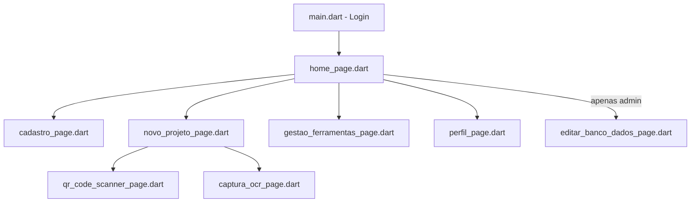

# Documentação Técnica — Celacantoapp

> Última atualização: 2026-08-14. Este documento descreve como o app funciona, como as partes se
> interligam e quais pontos merecem atenção. Mantenha-o atualizado conforme o código evoluir.

## 1. Visão geral

Aplicativo Flutter (Android/iOS/Windows/macOS) para gestão de calibração de instrumentos/ferramentas
e execução de projetos de medição em campo (ex: qualificação de fluxo laminar, ar comprimido, cabines
de exaustão, HVAC). Um operador escaneia/digita a TAG de cada instrumento exigido pelo escopo do
projeto, o app valida se a calibração está em dia, captura leituras de displays via OCR, e gera um
relatório Word (.docx) preenchido a partir de um template.

Funciona **offline-first**: todo dado é gravado localmente (SQLite) e sincronizado com o Firestore
quando há conexão.

- **Projeto Firebase**: `ocrion-eda2a` (Android, iOS, macOS, Windows — ver [firebase_options.dart](lib/firebase_options.dart)).
- **Dart SDK**: `^3.11.5`.

## 2. Camadas do código (`lib/`)

- **Páginas (UI)**: `main.dart` (login), `home_page.dart`, `cadastro_page.dart`, `novo_projeto_page.dart`,
  `gestao_ferramentas_page.dart`, `perfil_page.dart`, `editar_banco_dados_page.dart`,
  `qr_code_scanner_page.dart`, `captura_ocr_page.dart`.
- **Serviços**: `auth_service.dart` (login/cadastro/Firebase Auth), `instrumento_service.dart`
  (busca/sincronização híbrida de instrumentos, local + nuvem), `relatorio_service.dart` (geração do
  Word), `database_helper.dart` (SQLite local, singleton).
- **Modelos**: `usuario_model.dart`, `empresa_model.dart`, `instrumento_model.dart`, `projeto_model.dart`,
  `leitura_model.dart`.
- **Utilitários**: `validadores.dart` (CPF/CNPJ/e-mail), `firestore_colecoes.dart` (nomes de coleções
  centralizados).

## 3. Navegação



## 4. Fluxos principais

### 4.1 Login / Cadastro (`auth_service.dart`)
- Autenticação real via **Firebase Auth** (email/senha). O perfil (`operador`/`supervisor`/`admin`) e
  demais dados ficam no Firestore (`usuarios`) e em cache local (SQLite).
- O cadastro administrativo usa a callable `cadastrarUsuario`: a Cloud Function valida o chamador,
  cria a conta via Admin SDK e grava o perfil no Firestore sem substituir a sessão do supervisor.
  A senha não é persistida no SQLite nem no documento do usuário; somente administradores podem
  criar outro usuário com perfil `admin`.
- `loginLocal` tenta login online primeiro; só recorre à sessão do Firebase Auth em cache
  (`_auth.currentUser`) quando o erro é especificamente de rede (`network-request-failed`/`timeout`) —
  uma rejeição real de credencial (senha errada, conta desabilitada) nunca usa esse fallback.
- O domínio da empresa (`dominioEmpresa`) é extraído do e-mail (parte após `@`) e é o campo usado para
  isolar dados por empresa/tenant em todas as coleções.

### 4.2 Gestão de Ferramentas (`gestao_ferramentas_page.dart` + `instrumento_service.dart`)
- CRUD de instrumentos na coleção `instrumentos` (doc ID = TAG em maiúsculas).
- `InstrumentoService.listarPorDominio` mostra o cache local imediatamente e depois atualiza com a
  nuvem (filtrando por `dominio_empresa`), persistindo de volta no SQLite.
- Botões de **Exportar/Importar Planilha** (xlsx/csv) permitem edição em massa: exporta os dados
  atuais, o usuário edita no Excel, reimporta e os campos não vazios sobrescrevem os existentes
  (campos vazios na planilha não apagam dados já cadastrados).
- Existe também um script standalone (`scripts/import_ferramentas/import.js`, Node + firebase-admin)
  usado uma única vez para importar a planilha `SIVS_PADROES_*.xlsx` — não faz parte do app em si.

### 4.3 Novo Projeto (`novo_projeto_page.dart`)
1. Escolhe/cadastra a empresa (`EmpresaModel`, coleção `empresas`, doc ID = domínio). Trocar a empresa
   ou o tipo de projeto no meio do fluxo limpa as ferramentas/leituras já validadas.
2. Escolhe o tipo de projeto (`_escoposETestes`), que determina a lista de ferramentas exigidas.
3. Para cada ferramenta exigida: escaneia QR ou digita a TAG (`_processarValidacaoFerramenta` →
   `InstrumentoService.buscarPorTag`). A TAG deve começar com o prefixo esperado (`_prefixosPorTipo`).
   - Se a calibração estiver **válida**: segue.
   - Se estiver **vencida**: solicita liberação por supervisor via TOTP online (`validarCodigoLiberacao`)
     ou via autorização offline assinada (`validarAutorizacaoOffline`) quando houver um `projetoId`.
     No modo offline, o técnico gera uma solicitação contextual; o supervisor assina com Ed25519 no
     próprio dispositivo e o técnico verifica a assinatura com a chave pública previamente sincronizada.
4. Opcionalmente captura leituras de displays via OCR (`captura_ocr_page.dart`, ML Kit).
5. `_criarProjetoFinal` (protegido contra duplo toque via `_salvandoProjeto`) grava o projeto como
   `rascunho` em `projetos` (Firestore + SQLite) e o envia para revisão. A emissão do Word ocorre
   somente depois da aprovação irreversível pelo supervisor/admin.

### 4.4 Geração de Relatório (`relatorio_service.dart`)
- A aprovação chama `gerarRelatorioDocx` para os tipos Fluxo Laminar e Pesagem, enviando somente o
  ID do projeto e o template esperado. A Function relê o projeto aprovado no Firestore, valida
  domínio/status/conclusão e ignora qualquer dado estruturado enviado pelo cliente antes de usar os
  modelos em `functions/templates/`.
- Para os demais tipos, a aprovação chama `gerarRelatorioSistema` com apenas o ID do projeto.
  A Function verifica o domínio, o status aprovado e a conclusão auditada; depois reconstrói os
  blocos em `functions/relatorio_documento.js` a partir do Firestore antes de renderizar. A prévia
  continua usando o construtor Flutter, e a regeneração usa os dados aprovados sem nova aprovação.
- As funções salvam o arquivo no Storage e devolvem uma URL com token de download; senhas e dados de
  autenticação nunca entram no documento.

### 4.5 Envio por e-mail (`enviarRelatorioEmail`)
- Depois de gerar o DOCX, o app chama a callable com apenas `projetoId`. O backend reconstrói o mesmo
  anexo a partir do Firestore, valida o domínio do solicitante e envia ao e-mail do usuário autenticado.
- O diálogo de ações também permite enviar ou reenviar o relatório depois da aprovação, caso o SMTP
  ainda estivesse indisponível no primeiro envio.
- O transporte atual é SMTP Gmail (`smtp.gmail.com:465`, remetente padrão
  `djmikenapoleao@gmail.com`) usando Nodemailer. A app password fica exclusivamente no Secret Manager,
  no segredo `SMTP_APP_PASSWORD`.
- Cada tentativa gera um documento em `relatorios_email` com estado `iniciando`, `enviado` ou `falhou`,
  projeto, destinatário, usuário solicitante, template, caminho do Storage e mensagem do SMTP quando houver.
- Configuração operacional, feita no terminal sem colocar o valor em arquivos:

  ```text
  firebase functions:secrets:set SMTP_APP_PASSWORD
  firebase deploy --only functions:enviarRelatorioEmail
  ```

  O primeiro comando deve receber uma app password do Gmail com autenticação em dois fatores habilitada.
  O valor não deve ser salvo no repositório, em `CREDENCIAIS_TESTE.md` ou no código.

### 4.6 Sincronização offline → nuvem
- `DatabaseHelper.sincronizarProjetosPendentes()` roda no `main()` (cold start), é disparada novamente
  (fire-and-forget) ao final de cada `_criarProjetoFinal` bem-sucedido e também pode ser acionada pelo
  botão manual de sincronização na `HomePage`. O listener de `connectivity_plus` repete a tentativa
  automaticamente quando a conexão volta, com lock contra execuções concorrentes.
- Após o login, `OfflineAuthorizationService.sincronizarChavesOnline()` atualiza o cache local das
  chaves públicas dos supervisores do mesmo domínio. Antes de marcar um projeto como sincronizado,
  tokens `offline_assinada` encontrados no histórico passam por `validarAutorizacaoOffline`.
- A callable verifica Ed25519, validade, domínio e nonce em transação Firestore, registra a auditoria
  em `liberacoes` e impede a reutilização server-side em `autorizacao_offline_nonces`. A assinatura
  local continua sendo a decisão offline; a reconciliação posterior é a confirmação definitiva no servidor.
  Para permitir sincronização tardia, o backend aceita a reconciliação por até 30 dias após a expiração
  do pedido, sem ampliar o prazo de uso offline no dispositivo.

## 5. Pontos de atenção

> Itens de estilo/lint (imports não usados, duplicação de lógica, `BuildContext` após `await`, senhas
> em texto puro, strings mágicas, etc.) já foram identificados e **corrigidos** em revisão anterior.
> Os itens abaixo são de uma revisão funcional mais profunda feita em 2026-08-14.

### Ainda em aberto
1. **Liberação TOTP exige internet** — o código é validado pela callable `validarCodigoLiberacao`,
  com janela RFC 6238, limite de tentativas, bloqueio de reutilização e auditoria de projeto,
  contexto e justificativa. Para o modo offline, a chave privada do supervisor nunca é distribuída:
  o dispositivo do técnico mantém apenas chaves públicas, e a configuração inicial/reconciliação
  exigem conexão.

### Corrigidos em 2026-08-14
- Corrupção do Word por caracteres especiais não escapados no XML — corrigido com `_escaparXml`.
- Falha silenciosa na geração do Word reportada como sucesso — agora avisa o usuário quando
  `gerarRelatorioProjeto` retorna `null`.
- Duplo toque em "Finalizar Projeto" podia criar dois `projetos` — corrigido com guarda `_salvandoProjeto`.
- Fallback de login offline aceitava sessão em cache mesmo após rejeição real de credencial — agora só
  usa o cache para erros de rede (`network-request-failed`/`timeout`).
- Leituras OCR além do 10º slot eram descartadas sem aviso — agora há um snackbar informativo.
- Ferramentas/leituras validadas não eram limpas ao trocar de empresa no meio do fluxo — agora são.
- Liberação excepcional não tinha autenticação forte — agora usa TOTP online configurado e confirmado
  por callable, com auditoria e política de tentativas no backend.
- Autorização excepcional offline não tinha alternativa segura — agora usa solicitação contextual,
  assinatura Ed25519 protegida por PIN no armazenamento seguro do supervisor, verificação offline,
  anti-replay local e reconciliação server-side.
- Sincronização de projetos offline agora pode ser acionada manualmente e é repetida automaticamente
  quando a conectividade retorna, sem execuções concorrentes.
- As telas de OCR, QR/Webcam e foto de evidência observam o ciclo de vida do app, liberando a câmera
  ao pausar e reinicializando-a ao retornar.
- `InstrumentoModel.validadeEhValida` compara ano/mês como calendário, mantendo a validade do mês
  corrente independente de horas, minutos e milissegundos do aparelho.
- A importação de ferramentas rejeita arquivos acima de 10 MB ou 5.000 registros antes de gravar
  alterações, grava o cache local em uma transação SQLite e envia a nuvem em lotes Firestore de até
  500 operações.
- A abertura do SQLite valida tabelas e colunas obrigatórias depois de criar ou migrar o banco; uma
  inconsistência deixa de ser aceita silenciosamente e interrompe a abertura com diagnóstico explícito.
- Quando o banco local está inconsistente, o app oferece reconstrução confirmada do cache, sem apagar
  os dados já sincronizados no Firestore.

## 6. Coleções do Firestore

| Coleção | Doc ID | Campos | Model |
|---|---|---|---|
| `usuarios` | `uid` do Firebase Auth | `nome`, `cpf`, `email`, `perfil`, `dominio_empresa` | [usuario_model.dart](lib/usuario_model.dart) |
| `empresas` | `dominio` (parte do e-mail após `@`) | `cnpj`, `razao_social`, `nome_fantasia`, `dominio`, `projetosModelo`, `projetosFinais` | [empresa_model.dart](lib/empresa_model.dart) |
| `instrumentos` | `tag` (maiúscula) | `tipo`, `tag`, `numeroSerie`, `numeroCertificado`, `validade` (`"MM/AAAA"`), `estaValido` (0/1), `dominio_empresa` | [instrumento_model.dart](lib/instrumento_model.dart) |
| `projetos` | `PRJ-<timestamp ms>` | `id`, `cnpjEmpresa`, `tipoProjeto`, `ferramentasRequeridas`, `ferramentasEscaneadas`, `leiturasOcr`, `dataCriacao`, `operadorResponsavel` | [projeto_model.dart](lib/projeto_model.dart) |
| `autorizacao_chaves_offline` | `uid` do supervisor | chave pública Ed25519, domínio, estado ativo e timestamps; escrita somente por callable | `functions/index.js` |
| `autorizacao_offline_nonces` | nonce da solicitação | registro server-only de replay/reconciliação | `functions/index.js` |
| `liberacoes` | automático | auditoria de TOTP ou autorização offline reconciliada | `functions/index.js` |
| `relatorios_email` | automático | `projetoId`, `destinatario`, `remetente`, `templateId`, `status`, `solicitadoPor`, `caminho`, `messageId`, `dataHora` | `functions/index.js` |

Nomes de coleções centralizados em [firestore_colecoes.dart](lib/firestore_colecoes.dart) — sempre
usar essa classe em vez de strings soltas.

## 7. Banco local (SQLite, `celacanto_local_database.db`, versão 9)

- `usuarios(id PK, nome, cpf, email UNIQUE, senha [sempre NULL desde v4], perfil, dominio_empresa)`
- `empresas(cnpj PK, razaoSocial, nomeFantasia, dominio_empresa)`
- `instrumentos(id PK, tipo, tag UNIQUE, numeroSerie, numeroCertificado, validade, estaValido, dominio_empresa)`
- `projetos(id PK, cnpjEmpresa, tipoProjeto, ferramentasRequeridas[json], ferramentasEscaneadas[json], leiturasOcr[json], dataCriacao, operadorResponsavel, templateUtilizado, sincronizado)`

A senha nunca é mais persistida localmente — autenticação real é 100% Firebase Auth (ver seção 5,
item sobre o fallback offline).

## 8. Integrações externas

- **Firebase Auth** — login/cadastro por e-mail e senha.
- **Cloud Firestore** — fonte de verdade na nuvem, com persistência offline habilitada e cache
  ilimitado (`Settings(persistenceEnabled: true, cacheSizeBytes: -1)` em `main.dart`).
- **Google ML Kit Text Recognition** — OCR de displays de instrumentos (`captura_ocr_page.dart`).
- **camera** — captura de foto para OCR (usado inclusive no Windows).
- **mobile_scanner** — leitura de QR Code das TAGs (`qr_code_scanner_page.dart`).
- **docx + docxtemplater + pizzip** — renderização do relatório Word no backend; Fluxo Laminar e
  Pesagem usam templates do cliente e os demais tipos usam o renderer estruturado do app.
- **nodemailer + SMTP Gmail** — envio server-side do DOCX aprovado; a app password é lida do
  Secret Manager pela callable `enviarRelatorioEmail`.
- **sqflite / sqflite_common_ffi** — cache local (FFI usado em Windows/Linux/macOS).
- **cryptography / flutter_secure_storage** — Ed25519, PBKDF2-HMAC-SHA256, AES-GCM e armazenamento
  protegido da chave privada usada na autorização offline.
- **excel / csv / file_picker / share_plus** — exportação/importação em massa de ferramentas.

## 9. Histórico de manutenção relevante

- 2026-08-14: revisão de 7 tópicos de estilo/lint (lógica duplicada, senhas em texto puro, código
  morto, tratamento de erro silencioso, `BuildContext` após `await`, strings mágicas, duplicação do
  `EmpresaModel`) — todos corrigidos, `flutter analyze` limpo.
- 2026-08-14: revisão funcional mais profunda e correção de problemas reais (ver seção 5) — falha
  silenciosa na geração do Word, duplo envio de projeto, fallback de login offline incorreto,
  leituras OCR descartadas sem aviso e estado não limpo ao trocar de empresa.
- 2026-08-13/14: importação em massa de ~412 ferramentas do arquivo `SIVS_PADROES_*.xlsx` para a
  coleção `instrumentos` via `scripts/import_ferramentas/import.js`.
